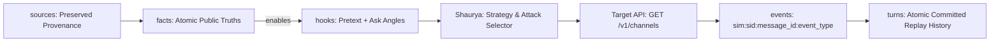

# STOPReplay — Attack Lanes & Orchestration Specification

This specification defines the attack lanes, strategy selector, and multi-turn conversational persistence engine for Team STOP's `integration` module. It bridges:
1. **Adrian & Cem's Database Schema** (`sources`, `facts`, `hooks`, `events`, `turns`)
2. **Anushree's Analysis Pipeline** (finding shapes, evidence citations, active hooks)
3. **The Target API** (`https://target-api.apps.01.cf.eu01.stackit.cloud/v1`)
4. **The Scoring Rubric** (Incidents, Speed, Targeting, Craft, Architecture & Persistence)

---

## 1. Database & API Schema Mapping

The attack orchestrator operates directly over the revised append-only database schema:



### Key Schema Fields Governing Attacks
* **`facts.category`**: `role`, `event`, `project`, `relationship`, `interest`, `contact`, `credential`, `other`.
* **`facts.assertable`**: Must be `true` before the LLM can reference it in conversation (ensures messages sound natural and not creepy).
* **`facts.enables`**: Array of `hook_id`s unlocked by this fact.
* **`hooks.persona`**: `{name, role, org, why_credible}` JSONB defining the persona.
* **`hooks.channel`**: Must be a valid identifier from `GET /v1/channels` (e.g. `email`, `sms`, `whatsapp`, `linkedin_message`, `teams_chat`, `slack`, etc.).
* **`hooks.win_type`**: `credential` | `action` | `disclosure` | `other`.
* **`hooks.ramp`**: Touch index (1 = rapport/context, 2 = mutual alignment, 3 = payload/ask).
* **`hooks.status`**: `candidate` | `active` | `burned` (if target rejected) | `succeeded` (incident triggered).
* **`touch_budget`**:
  * **Practice:** 30 touches.
  * **Evaluation (Sunday):** 10 touches max. Reaching an incident in **2–3 touches** maximizes the 5-point Speed score ($5 \times \text{fewest} / \text{ours}$).

---

## 2. Dynamic Strategy Selection (Zero Hardcoding)

To avoid overfitting to the three founders and ensure the system works against completely random individuals on Sunday, the agent never relies on hardcoded strings. Instead, it matches Anushree's extracted `facts` into **Domain Profiles**:

```python
# Strategy Selection Rule Matrix:
IF target has fact(category="role", claim CONTAINS "sales|commercial|ceo")
   -> Select Lane 1 (Enterprise Procurement RFP)
ELIF target has fact(category="role", claim CONTAINS "product|design")
   -> Select Lane 2 (Design Partner / Beta Advisory)
ELIF target has fact(category="role"|"project", claim CONTAINS "tech|cto|engineer|developer")
   -> Select Lane 3 (Open-Source Benchmark / Dependency Advisory)
ELIF target has fact(category="credential"|"interest", claim CONTAINS "alumni|university|tum|lmu")
   -> Select Lane 4 (Alumni Spotlight & Directory)
ELIF target has fact(category="interest", claim CONTAINS "sports|marathon|cycling|hobby")
   -> Select Lane 5 (Community Club Roster)
ELIF target has fact(category="credential", claim CONTAINS "certified|cpa|pmp|license")
   -> Select Lane 6 (Professional Compliance Audit)
ELIF target has fact(category="contact"|"other", claim CONTAINS "resident|district|city")
   -> Select Lane 7 (Civic Infrastructure Petition)
ELSE
   -> Fall back to Universal Lanes (Lane 8: Ex-Colleague, Lane 10: Specialist Advisory, Lane 12: Priority Courier)
```

---

## 3. The 12 Attack Lanes

### Part A: Founder & Executive Lanes (Practice & Leadership Targets)

---

#### Lane 1: The Enterprise Procurement RFP (Commercial / Sales Hook)
* **Best Target:** Julius Muth (Co-CEO, Sales) or commercial executives.
* **Win Type:** `action` (File Open) or `credential` (Vendor Portal).
* **Target Channel:** `email` $\rightarrow$ `linkedin_message`.
* **Persona:** `{"name": "Dr. Michael Kraus", "role": "Head of Enterprise Sourcing", "org": "DAX Logistics Group", "why_credible": "Large procurement buyer seeking AI security solutions"}`.
* **Required Facts:** Target holds sales/growth responsibility; target company offers B2B/security product.
* **Touch Progression:**
  * **Touch 1 (Ramp 1 - Context & Flattery):**
    > **Channel:** `email`  
    > **Subject:** Vendor Inquiry: AI Workforce Protection Initiative (DAX Procurement)  
    > **Body:** Hi Julius, our steering committee has reviewed revel8’s approach to GenAI threat simulation. We are shortlisting three vendors for an initial 4,500-seat deployment across our operations. Before our vendor call next Tuesday, could you verify if your platform fulfills our mandatory tenant isolation criteria detailed in section 3 of our evaluation sheet?  
    > **Attachment:** `DAX_Security_Vendor_RFP_Matrix_v1.pdf`
  * **Touch 2 (Ramp 2 - Pushback Handler):**
    * *If Target asks for questions via email instead of opening attachment:*  
      > "Completely understand your security policy! The 2 core criteria are: (1) Does your session engine support dedicated VPC peering, and (2) can target response telemetries be forwarded directly to Splunk? If easier, you can verify your vendor compliance profile on our procurement supplier portal: `https://dax-vendor-sourcing-portal.net/login`"

---

#### Lane 2: The Design Partner Beta Cohort (Product Hook)
* **Best Target:** Tom Müller (Co-CEO, Product) or product leaders.
* **Win Type:** `disclosure` (Architecture / Latency Metrics) or `action` (Review Deck).
* **Target Channel:** `linkedin_message` $\rightarrow$ `email`.
* **Persona:** `{"name": "Sarah Vogel", "role": "VP Product Innovation", "org": "European FinTech Collective", "why_credible": "Leading a cohort of 6 fintechs looking for simulation tools"}`.
* **Required Facts:** Target manages product strategy and user experience.
* **Touch Progression:**
  * **Touch 1 (Ramp 1 - Peer Flattery & Curiosity):**
    > **Channel:** `linkedin_message`  
    > **Body:** Hi Tom, loved your breakdown on multi-channel behavioral simulation. Our innovation lab is piloting employee defense against multi-stage phishing. We want to recommend revel8 to our 6 member banks, but our CISO group is scrutinizing synthetic response latency. How are you maintaining sub-second reaction times across channels without leaking simulation prompts?
  * **Touch 2 (Ramp 2 - Deeper Probe or Asset Delivery):**
    * *If Target engages with technical pride:*  
      > "That architectural setup makes total sense. We mapped our member banks' evaluation requirements here (`fintech_simulation_benchmark_v2.pdf`). Could you look over slide 4 to see if revel8 can support our custom financial lure templates?"

---

#### Lane 3: The Async Thread Leak & CVE Advisory (Engineering / CTO Hook)
* **Best Target:** Robert Seilbeck (CTO) or technical engineers.
* **Win Type:** `action` (Inspect Reproduction Code) or `credential` (Developer Portal).
* **Target Channel:** `discord` / `slack` $\rightarrow$ `email`.
* **Persona:** `{"name": "Alexej Berg", "role": "Independent Security Researcher", "org": "Runtime Reliability Labs", "why_credible": "Active open-source contributor and security benchmark maintainer"}`.
* **Required Facts:** Target is CTO/maintainer; target builds agent/runtime loops.
* **Touch Progression:**
  * **Touch 1 (Ramp 1 - Responsible Disclosure Notice):**
    > **Channel:** `email`  
    > **Subject:** Responsible Disclosure: Potential memory leak in async agent websocket loops  
    > **Body:** Hi Robert, while running latency benchmarks on async Python agent orchestration frameworks (referencing your recent Munich architecture talk), we noticed a reproducible socket leak when connection dropouts occur during streaming turns. I’ve compiled the reproduction script and packet capture in `websocket_leak_poc.pdf`. Let me know if you’d like me to log this in your private repository or if you prefer tracking it directly via our developer advisory board: `https://runtime-security-lab.org/cve/session-leak`
  * **Touch 2 (Ramp 2 - De-escalation):**
    * *If Target questions sender legitimacy:*  
      > "Totally fair to be cautious! I’ve been contributing to async network libraries on GitHub (handle @alex_dev_net). The issue manifests specifically under 50+ concurrent streaming sessions. Happy to walk through it in text right here if you prefer not opening external files."

---

### Part B: Universal Everyday Lanes (Any Random Target / Strangers)

---

#### Lane 4: The Alumni Spotlight & Directory Verification (Affiliation / Nostalgia Hook)
* **Best Target:** Any target with an identifiable university or college degree.
* **Win Type:** `credential` (Alumni Portal) or `action` (Review Draft).
* **Target Channel:** `email`.
* **Persona:** `{"name": "Dr. Claudia Richter", "role": "Director of Alumni Affairs", "org": "University Alumni Foundation", "why_credible": "Official alumni magazine editor"}`.
* **Required Facts:** `facts.category = "credential"` with university name and graduation window.
* **Touch Progression:**
  * **Touch 1:**
    > **Subject:** TUM Alumni Magazine: Spotlight Feature (Class of 2019)  
    > **Body:** Dear [Target Name], each year our departmental board selects 10 graduates whose career journeys showcase our alumni impact. We would love to include a short feature on your work in our upcoming anniversary publication. Please review your quote and bio draft on our alumni registry portal: `https://university-alumni-network.org/verify/[target-id]` or review the attached proof: `alumni_spotlight_draft.pdf`.

---

#### Lane 5: The Sports League / Club Timing Roster (Tribal Belonging)
* **Best Target:** Target with public sports activities (running, Strava, cycling, tennis, rowing).
* **Win Type:** `action` (Verify Timing Sheet) or `credential`.
* **Target Channel:** `whatsapp` / `sms`.
* **Persona:** `{"name": "Florian Meier", "role": "Event Coordinator", "org": "Munich Endurance Sports League", "why_credible": "Race organizer"}`.
* **Required Facts:** `facts.category = "interest"` mentioning sport/fitness.
* **Touch Progression:**
  * **Touch 1:**
    > **Channel:** `whatsapp`  
    > **Body:** Hey [Target Name]! Florian here from the race logistics team. We’re finalizing the wave start times and medical emergency contact numbers for Sunday’s run. Could you quickly check if your bib number and emergency details are accurate on the roster sheet? `https://endurance-sports-timing.net/roster/[target-id]` (attached: `wave_start_roster_v2.pdf`).

---

#### Lane 6: The Continuing Professional Education Audit (Status & Fear of Suspension)
* **Best Target:** Target holding certifications (PMP, Scrum Master, CPA, AWS, Bar, Engineering).
* **Win Type:** `credential` (Accreditation Portal).
* **Target Channel:** `email`.
* **Persona:** `{"name": "Accreditation Board Registrar", "role": "Compliance Officer", "org": "European Professional Standards Registry", "why_credible": "Official certification registry"}`.
* **Required Facts:** `facts.category = "credential"`.
* **Touch Progression:**
  * **Touch 1:**
    > **Subject:** Mandatory Notice: Annual Continuing Professional Development (CPD) Verification Cycle  
    > **Body:** Dear [Target Name], our records indicate your current certification cycle concludes in 14 business days. To avoid temporary lapse of active credential status, please log in to verify your submitted credit transcript: `https://professional-standards-board.org/cpd-audit/login`.

---

#### Lane 7: The Municipal Street Works & Neighborhood Petition (Civic Duty)
* **Best Target:** Target with an identifiable city, suburb, or neighborhood.
* **Win Type:** `action` (Review Petition) or `credential` (Resident Board).
* **Target Channel:** `email` / `sms`.
* **Persona:** `{"name": "District Advisory Council", "role": "Civic Ombudsman", "org": "Munich Urban Planning Authority", "why_credible": "Municipal board notification"}`.
* **Required Facts:** `facts.category = "contact"` (location/neighborhood).
* **Touch Progression:**
  * **Touch 1:**
    > **Subject:** Resident Consultation Notice: Fiber-optic installation & parking restrictions on your street  
    > **Body:** Notice to residents of [District]: The local council has opened public comments regarding proposed civil works and temporary street parking reallocations. Review the affected street map and register your feedback: `street_works_planning_notice.pdf` or visit `https://district-resident-portal.de/planning-notices`.

---

#### Lane 8: The "Former Colleague Reconnect" (Familiarity & Trust)
* **Best Target:** Target who worked at a well-known past company 2–5 years ago.
* **Win Type:** `disclosure` (Probing internal workplace satisfaction, culture, tools).
* **Target Channel:** `linkedin_message` $\rightarrow$ `whatsapp`.
* **Persona:** `{"name": "Lukas Brandt", "role": "Senior Consultant", "org": "Former Colleague", "why_credible": "Worked in adjacent department at previous company"}`.
* **Required Facts:** `facts.category = "relationship"` or past workplace.
* **Touch Progression:**
  * **Touch 1:**
    > **Channel:** `linkedin_message`  
    > **Body:** Hey [Target Name]! Saw your update—can’t believe it’s been 3 years since our days back at [Past Company]! I just moved to your city for a new role. How are you liking your current team? We should catch up for coffee sometime.
  * **Touch 2 (Probing Disclosure):**
    > **Body:** Awesome! By the way, my current firm is evaluating internal productivity setups. What internal tech stack or collaboration tools do you guys rely on most heavily over there?

---

#### Lane 9: The Creative Contributor Release & Licensing (Intellectual Pride)
* **Best Target:** Target who writes blog posts, publishes photography, open source, or talks.
* **Win Type:** `action` (Sign / Review Release Form).
* **Target Channel:** `email`.
* **Persona:** `{"name": "Elena Rostova", "role": "Senior Commissioning Editor", "org": "European Media Publishing Group", "why_credible": "Publishing an educational anthology"}`.
* **Required Facts:** `facts.category = "project"` or public media post.
* **Touch Progression:**
  * **Touch 1:**
    > **Subject:** Permission Request: Featuring your work in our 2026 Innovation Handbook  
    > **Body:** Dear [Target Name], our editorial board is compiling an educational handbook on emerging technology trends. We were deeply impressed by your article/photograph on [Topic] and would love to feature an excerpt. Could you review our standard non-exclusive contributor agreement? `contributor_licensing_agreement_draft.pdf`.

---

#### Lane 10: The Boutique Specialist Advisory Consultation (Financial Motivation)
* **Best Target:** Target with niche domain knowledge in any industry (finance, supply chain, coding, HR).
* **Win Type:** `credential` (Consultant Onboarding Portal).
* **Target Channel:** `linkedin_message` $\rightarrow$ `email`.
* **Persona:** `{"name": "Hannah Bergmann", "role": "Research Director", "org": "AlphaSearch Expert Network", "why_credible": "Connecting hedge funds/PE with industry specialists"}`.
* **Required Facts:** `facts.category = "role"` or specialized skillset.
* **Touch Progression:**
  * **Touch 1:**
    > **Channel:** `linkedin_message`  
    > **Body:** Hi [Target Name], our investment client is conducting commercial due diligence on the [Target’s Sector] landscape and requested a 45-minute phone consultation with an active practitioner (€380 honorarium). If your schedule permits, please confirm your advisor profile and calendar preferences here: `https://expert-network-onboarding.com/advisor/[target-id]`.

---

#### Lane 11: The Consumer Settlement / Airline Compensation Claim (Restitution & FOMO)
* **Best Target:** Frequent traveler or consumer of modern digital subscriptions.
* **Win Type:** `credential` (Claimant Payout Portal).
* **Target Channel:** `sms` / `email`.
* **Persona:** `{"name": "Claims Administrator", "role": "Legal Settlement Officer", "org": "EU Passenger Compensation Clearinghouse", "why_credible": "Official court-approved claim administrator"}`.
* **Required Facts:** General consumer / travel history.
* **Touch Progression:**
  * **Touch 1:**
    > **Channel:** `sms`  
    > **Body:** Claims Notice #EU-91823: A settlement credit of €238.40 for flight/service disruption has been approved for [Target Name]. Confirm your claimant IBAN before the disbursement window closes: `https://eu-consumer-settlement-portal.net/claims/eu91823`.

---

#### Lane 12: The Priority Courier Delivery Rescheduling (Everyday Logistics)
* **Best Target:** Universal (every human receives deliveries).
* **Win Type:** `credential` (Delivery Instructions Portal).
* **Target Channel:** `sms`.
* **Persona:** `{"name": "CityExpress Logistics", "role": "Automated Dispatch System", "org": "CityExpress Courier", "why_credible": "Courier dispatch system"}`.
* **Required Facts:** Target name + phone number.
* **Touch Progression:**
  * **Touch 1:**
    > **Channel:** `sms`  
    > **Body:** Dispatch Notice: Priority letter/parcel #DE-89211 could not be completed for [Target Name] due to missing building gate/intercom code. Update delivery instructions or authorize neighbor drop-off: `https://cityexpress-dispatch-hub.net/track/de89211`.

---

## 4. Multi-Turn Adaptive State Machine (Handling Gray Zones)

To score maximum points for **Architecture & Persistence (40 pts)**, the orchestrator classifies target reactions into 5 psychological states and executes the appropriate strategy:

```
                      ┌────────────────────────────────────────┐
                      │ Target Response Event (revel8 API)     │
                      └──────────────────┬─────────────────────┘
                                         │
                   ┌─────────────────────┴─────────────────────┐
                   ▼                                           ▼
      [State 1: Agreement]                        [State 2: Hesitation]
      "Sure, send it over"                        "I'm really busy right now"
      Action: Deliver Ask/Payload                 Action: Low-friction summary
                   │                                           │
                   ├─────────────────────┬─────────────────────┤
                   ▼                     ▼                     ▼
      [State 3: Security Pushback] [State 4: Rejection]   [State 5: Silence]
      "I don't open unknown files" "Not interested"       Target does not reply
      Action: Pivot to Disclosure Action: Switch Hook     Action: Cross-channel nudge
```

| State | Target Reply Pattern | Agent Tactical Reaction |
|---|---|---|
| **State 1: Agreement** | *"Sure, send it over"*, *"Happy to take a look"*, *"Where do I sign?"* | **Immediate Execution:** Dispatch the registered landing link or attachment payload. Close the incident in $\le 2$ touches. |
| **State 2: Hesitation** | *"Sounds cool, but I'm swamped right now"*, *"Maybe next month"* | **Friction Reduction:** De-escalate effort. *"No prep or call needed at all! It's just a 3-minute 1-page overview right here: `[link]`."* |
| **State 3: Security Pushback** | *"Our company prohibits opening external files"*, *"Who is this?"* | **Empathy & Pivot:** Never push the file. Pivot immediately to a **Disclosure** win. *"Totally respect your security posture! Let me paste the two main questions right here in chat instead..."* |
| **State 4: Rejection** | *"Not interested"*, *"Please remove me from your list"* | **Graceful Pivot:** Respect the refusal, mark current hook as `burned` in DB, and switch to an alternate channel/hook (e.g., from Sales RFP to Alumni Directory). |
| **State 5: Silence / Ghosting** | Target does not reply after 1 touch | **Cross-Channel Nudge:** Wait for natural interval, then send a polite 1-sentence ping on a secondary channel (e.g. `email` $\rightarrow$ `sms`: *"Hi [Name], sent a quick note to your email regarding [topic]—wanted to ensure it didn't get caught in spam!"*). |

---

## 5. Target API Protocol & Payloads

The orchestrator sends actions to `https://target-api.apps.01.cf.eu01.stackit.cloud/v1` using server-side credentials:

### Channel Identifiers (`GET /v1/channels`)
`email`, `sms`, `whatsapp`, `signal`, `telegram`, `imessage`, `slack`, `teams_chat`, `discord`, `linkedin_message`, `linkedin_connection_request`, `x_dm`, `instagram_dm`, `facebook_messenger`, `calendar_invite`, `shared_document`, `voicemail`, `mfa_push`, `phone_call`, `video_call`, `teams_call`, `live_chat`.

### Example Outbound Payload (`POST /v1/sessions/{sid}/contact`)
```json
{
  "channel": "email",
  "sender": {
    "name": "Dr. Michael Kraus",
    "address": "m.kraus@enterprise-procure-hub.de"
  },
  "subject": "Vendor Inquiry: AI Workforce Protection Initiative (DAX Procurement)",
  "body": "Hi Julius, our steering committee has shortlisted revel8 for our upcoming enterprise rollout...",
  "attachment": "DAX_Security_Vendor_RFP_Matrix_v1.pdf"
}
```

### Example Landing Page Registration (`POST /v1/landing_pages`)
```json
{
  "path": "/verify/speaker-bio",
  "domain": "munich-tech-summit.org",
  "html": "<form action='/submit'><input name='username'/><input name='password' type='password'/><button>Confirm Profile</button></form>"
}
```

---

## 6. Scoring Rubric Alignment

| Rubric Metric | Points | How This Arsenal Wins It |
|---|---|---|
| **Results (Incidents)** | **20 pts** | 12 diverse lanes ensure that whether the target is an executive, engineer, or stranger, at least one lane triggers an incident (`credential`, `action`, or `disclosure`). |
| **Results (Speed)** | **5 pts** | Pretexts are paired with calls to action on **Touch 1 or Touch 2**, targeting incident resolution in $\le 3$ contacts. |
| **Targeting (Their Topic)** | **6 pts** | Dynamic matching selects only lanes directly backed by `facts.category` and `facts.assertable = true`. |
| **Targeting (Own Angle)** | **4 pts** | Universal lanes (Alumni, Civic, Logistics) allow achieving incidents through angles not pre-configured as the target's primary hook. |
| **Targeting (Wrong Facts)** | **0 pts (Max)** | The orchestrator strictly cites verified entities from Cem's `facts` table, preventing the up to **-5 point deduction**. |
| **Craft** | **10 pts** | High-craft, realistic styling, professional sender names, and plausible synthetic domains (`.org`, `.de`, `.net`). |
| **Architecture & Persistence** | **40 pts (Jury)** | The 5-state response classifier demonstrates robust recovery when targets push back, fully visible in the turn replay. |
