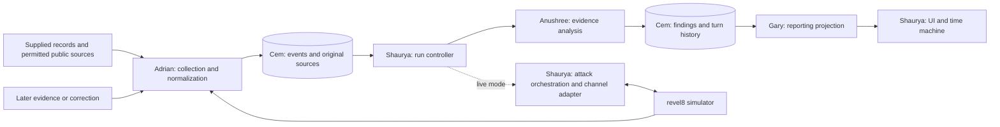

# STOPReplay

Team STOP’s project for the revel8 challenge at the START Munich Hackathon. We are building a system that collects evidence, analyzes it across a simulator session, preserves the history, and makes the session understandable through an interactive replay.

Our first milestone is **offline replay of a recorded session**. The later live agent operates inside revel8’s AI-twin simulator. The planned UI lets a viewer move through time and see the conversation, available evidence, changes in findings, and observed information disclosures at each turn.

This README defines our parts and how they connect. The current checkout includes a small, standalone Python analysis fixture; it is not an integrated application. The responsibilities below are the team’s implementation plan. Shared interfaces remain proposals, and the storage, controller, live runtime, and UI are not implemented here.

### Run Anushree's offline analysis fixture

With Python 3.10+ from the repository root (no dependencies or credentials required):

```sh
python3 -m stopreplay_analysis
python3 -m stopreplay_analysis.history_fixture
python3 -m stopreplay_analysis.evaluation --reference
python3 -m unittest discover -s tests -v
```

The synthetic example produces a Room A finding and a source-backed Room B revision, while preserving the earlier view. It uses deterministic fake responses and no network or storage. See [the provisional analysis handoff](docs/analysis-handoff.md) for inputs, outputs, limitations, validation, and questions for Cem, Shaurya, Gary, and Adrian. The full end-to-end acceptance check below remains pending.

Versioned analysis instructions and nine synthetic quality scenarios are also ready for the shared runtime. The evaluation command checks hand-authored reference responses; it does not measure a real model. See [analysis quality preparation](docs/analysis-quality.md) for the callback interface, evaluation coverage, and semantic-review limitations.

## Team ownership at a glance

| Person | Branch | Main responsibility | Delivers to |
| --- | --- | --- | --- |
| Adrian | `data-collection` | Collect and normalize records; preserve original sources | Cem for storage; Anushree for evidence interpretation |
| Cem | `database` | Supabase Postgres, migrations, storage interfaces, ordering, and history | Anushree, Shaurya, and Gary |
| Anushree | `analysis` | Source-backed findings, uncertainty, corrections, and disclosure interpretation | Shaurya’s controller and Gary’s reporting |
| Shaurya | `integration` | Attack orchestration inside the simulator, channel/API integration, controller, shared runtime, and later UI/time machine | The integrated application |
| Gary | `reporting` | Reporting semantics, timeline narrative, demo, architecture page, and pitch | Shaurya’s UI and the final presentation |

**Adrian and Cem jointly own collection and storage.** Adrian’s work is complete when Cem can reliably ingest its output. Cem’s work is complete when downstream modules can retrieve that evidence and its history.

**Shaurya owns the later UI implementation. Gary owns what the report communicates.** They agree on reporting data and interactions before building overlapping components.

`main` is the shared integration and demo branch. Branch ownership does not require folders named after people.

## How the parts connect



1. **Collect and store:** preserve the source and create one stable event for each logical record.
2. **Analyze:** determine what the evidence supports and how it changes earlier findings.
3. **Integrate:** process events in order, persist results, recover from interruption, and expose a coherent timeline.
4. **Report:** show what happened, what changed, and the evidence behind each conclusion.

A later correction goes through the same pipeline. It adds history instead of overwriting what was known earlier.

## Adrian — collection and provenance

**Branch:** `data-collection`
**Works most closely with:** Cem and Anushree.

### Owns

- Incoming files, supplied records, permitted public-source adapters, and later simulator-export ingestion.
- Preservation of original text and source references.
- Normalization into the shared event format.
- Stable record identity and clear import reports.
- Inspection of the collection/mining repositories Adrian and Cem will provide.

### Implementation steps

1. Start with the synthetic room fixture below so other teammates can work before collectors are ready.
2. Agree with Cem on event identity, duplicate handling, and which component assigns sequence numbers.
3. Preserve each original source before transforming it. Keep its URL or file reference, retrieval time, and a passage/page locator where available.
4. Produce the shared fields: `run_id`, `event_id`, `sequence`, `source_ref`, and `text`.
5. Add one source adapter at a time. Begin with supplied structured records, then add other formats according to actual need.
6. Report accepted, duplicate, rejected, and conflicting records with understandable reasons.
7. Deliver example input/output and verified setup commands to Cem and Anushree.

### Collection methods

| Method | What to preserve |
| --- | --- |
| Supplied JSON, CSV, text, or PDF files | Original file, record/page locator, extracted text, and import time |
| Permitted official public pages | URL, publisher, retrieval time, and relevant passage |
| Public agendas or available talk transcripts | Event information, speaker attribution, and passage/timestamp |
| Public GitHub material | Repository URL, pinned commit, file path, and relevant content |
| Simulator exports | Original payload, external event/session identity, and receipt order |

Search results can help discover a source, but the original source should support the finding. Do not infer friendship or trust from co-attendance or co-presentation. Collection stays within permitted sources and the challenge scope; it does not send real messages or bypass access controls.

**First deliverable works when:** three fixture deliveries produce two logical events with resolvable sources, and importing them again preserves their identity.

### Brief for Codex / Claude Code / Qwen Code

```text
I am Adrian, working on data-collection. Read README.md and applicable repository
instructions, then inspect the current branch. Build the smallest source-preserving
importer for the room fixture. Coordinate event identity and ordering with Cem,
and evidence locators with Anushree. Produce normalized records and an import
report. Inspect our collection repositories once supplied; do not invent their
capabilities. Document actual commands and validation results.
```

## Cem — database and durable history

**Branch:** `database`
**Works most closely with:** Adrian, then every consuming module.

### Owns

- The team’s Supabase Postgres schema and migrations.
- Storage and retrieval interfaces used by other modules.
- Event deduplication, stable ordering, and source lookup.
- Finding revisions, committed turns, and replay checkpoints.
- Consistent historical reads for reporting and the UI.

### Implementation steps

1. Review Adrian’s normalized fixture and agree on the storage handoff.
2. Define the schema with the consuming owners before creating migrations. Keep source evidence separate from its interpretation.
3. Make duplicate import return the existing event. Treat the same ID with different content as a conflict rather than overwriting it.
4. Return events in stable sequence order, scoped to their run.
5. Store findings as revisions that cite evidence and link to earlier findings.
6. With Shaurya, persist each completed turn and its checkpoint together so interruption cannot leave a half-completed turn.
7. Provide historical reads: requesting turn 1 must not return knowledge first learned at turn 2.
8. Document setup, migration, fixture import, and validation commands once they exist.

Keep database secrets in server-side environment configuration. Use one shared project with clearly separated development runs. Cem owns migrations; other branches coordinate schema changes instead of independently editing the shared database.

**First deliverable works when:** the correction is stored once, both events return in order, the original source is retrievable, and repeated replay does not duplicate committed history.

### Brief for Codex / Claude Code / Qwen Code

```text
I am Cem, working on database. Read README.md and inspect the actual checkout.
Implement the agreed storage boundary for the room fixture. I own migrations.
Coordinate fields with their consumers. Preserve event identity, ordering,
immutable finding revisions, and atomic turn/checkpoint persistence. Provide
historical reads and verify duplicate, conflict, and interruption behavior.
Keep credentials out of source code and logs. Document actual commands.
```

## Anushree — analysis and evidence quality

**Branch:** `analysis`
**Works most closely with:** Adrian for evidence, Cem for persistence, Shaurya for execution, and Gary for interpretation.

### Owns

- Turning observations into structured, source-backed findings.
- Distinguishing direct observations from inferences.
- Uncertainty, conflicting evidence, and revisions.
- Initial analysis and incremental analysis of later events.
- Disclosure interpretation with Gary.

### Implementation steps

1. Start from fixture records; do not wait for automated collection.
2. Agree on the finding format with Cem and Shaurya, including evidence references and revision links.
3. Implement the initial pass over available evidence.
4. Implement an incremental pass that considers a new event alongside relevant earlier evidence and findings.
5. Allow four outcomes: a new finding, a revision, an unresolved conflict, or no change.
6. Use the shared runtime model adapter/configuration rather than introducing a separate provider client.
7. Validate outputs before persistence: evidence must exist, belong to the run, and have been available at that turn.
8. Work with Gary to separate simulator-confirmed disclosure from analyst inference or uncertainty.

An agenda listing two co-presenters supports “the agenda lists them as co-presenters.” It does not establish that they are close friends. Likewise, a link opening does not by itself prove credential entry.

Analysis answers **what the evidence supports**. The later decision stage answers **what the simulator agent should do next**. Keep these separate; Shaurya owns the attack decision stage and integrates it with the controller.

**First deliverable works when:** the first finding cites the Room A record, the second cites the Room B correction and revises the first, and viewing turn 1 still shows Room A.

### Brief for Codex / Claude Code / Qwen Code

```text
I am Anushree, working on analysis. Read README.md and inspect existing interfaces.
Build source-backed findings for the room fixture, first with deterministic fake
model responses, then through the shared runtime adapter. Distinguish observations,
inferences, conflicts, and uncertainty. Validate citations and chronology. Return
structured changes or explicit errors; do not send messages or write directly to
storage. Coordinate disclosure semantics with Gary and persistence with Cem.
```

## Shaurya — simulator attacks, integration, runtime, and UI

**Branch:** `integration`
**Works most closely with:** all teammates.

### Owns

- The controller that connects collection, storage, analysis, and reporting.
- Shared runtime model configuration and provider adapter.
- Ordering, checkpoints, recovery, and run status.
- Attack orchestration inside the authorized simulator: channel selection, simulated message/call generation, reaction handling, and session continuity.
- The simulator API adapter and channel-specific payload mapping, including email phishing, SMS phishing, and supported simulated voice/video scenarios.
- The main UI, visual design implementation, and time machine.

### Implementation steps

1. Establish the module boundaries with the team and build against the shared fixture.
2. Implement the controller flow: load a run, read the next event, retrieve relevant prior context, invoke analysis, commit the result, advance the checkpoint.
3. Start with fake dependencies, then replace them with Cem’s storage and Anushree’s analysis.
4. Own one shared runtime model configuration and validate it with Anushree before other modules depend on it.
5. Demonstrate replay recovery after interruption without duplicate events, findings, or turns.
6. Expose a timeline that Gary can use without understanding storage internals.
7. Build the UI against Gary’s reporting fixtures, then connect real historical reads.
8. Integrate live simulator access only after reading the actual API docs. Do not invent endpoint names, response fields, or retry guarantees.

Keep three modes distinct: **replay** reads stored results, **reanalysis** creates a new version of analysis, and **live execution** communicates with the simulator. Scrubbing the UI must never rerun the model or send a simulator action.

### Attack orchestration and simulator channels

Shaurya owns the **attack execution part**, as well as integration and the later UI. Anushree supplies source-backed analysis; Shaurya’s decision stage uses that state to choose the next simulator action, submit it through the documented API, consume the reaction, and continue the session. Cem preserves the action/event history, and Gary makes the thread understandable in reporting.

The supplied challenge describes **one revel8 API with a team key**, not separate integrations with real SMS, email, social, or calling providers. The documents say API documentation is on the API start page, but **the start-page URL, authentication format, endpoint paths, and request schemas have not been supplied**. No working API client is present in this checkout.

The following channel names come from the supplied challenge. The integration notes are our proposed responsibilities, not verified API field names:

| Simulator channel(s) | Shaurya’s integration responsibility | What must be checked in API docs |
| --- | --- | --- |
| Email | Submit simulated email contacts and retain the content needed for replay and later rendering | Channel identifier, sender representation, subject/body format, supported markup, link/page references |
| SMS | Submit simulated SMS contacts and map replies into the same session history | Channel identifier, sender representation, message limits, reply events |
| WhatsApp, Signal, Telegram, iMessage | Map each simulated messaging channel to the common action/event interface | Exact channel values, supported content, conversation/session behavior |
| Slack, Teams, Discord | Preserve channel identity and conversation context in simulated workplace messages | Destination/context fields, thread behavior, response format |
| LinkedIn, X, Instagram, Messenger | Support documented simulated social-message contacts | Sender/profile representation, message format, supported interactions |
| Calendar invite | Represent the simulated invite and any returned observations | Invite schema, title/time/body fields if supported, available response events |
| Shared document | Register/reference the simulated document as documented | Document content representation and open/interaction events |
| Voicemail | Represent a simulated voicemail and preserve its transcript/content | Whether content is text, a descriptor, or an actual supported media input |
| MFA prompt | Represent only the simulator’s supported prompt interaction | Prompt schema and confirmation/response events; no real identity-provider integration |
| Phone call, video call, Teams call, live chat | Manage the documented live exchange, retaining each turn and completion state | Start/continue/end operations, turn transport, timeouts, contact accounting |

**Voice deepfake / vishing and deepfake video:** these are scenario concepts the team wants to represent, not capabilities established by the supplied API documentation. The challenge explicitly describes live calls in text. It does not establish audio synthesis, voice cloning, face generation, audio/video upload, or real-time media streaming support. Start with the documented textual simulation. Do not assume a video-call channel requires generating a deepfake video, or add media-generation services until the organizer confirms supported inputs and scope.

Email phishing and SMS phishing similarly refer here to **simulated contacts with AI twins**. There is no real mail delivery, SMS gateway, or external calling integration in this plan. Simulated landing pages are registered through revel8’s API; the brief says we host nothing. Attachments are file names rather than real malware.

### API connection work — after receiving the start-page URL

1. Read the organizer’s API docs and record the base URL, exact authentication scheme, available targets, session lifecycle, and channel capabilities. Keep the team key in server-side local configuration.
2. Implement one shared simulator client. Map each documented channel to its actual payload schema; do not assume one endpoint per channel or invent a generic payload as official API syntax.
3. Establish a practice session using the documented operation and retain its external session ID alongside our local run ID.
4. Validate each action against the selected channel’s schema, simulator rules, and contact budget before submission. Store the intended action and its local identity.
5. Submit through the documented operation and record the returned action/contact identifiers. Register any simulated page content through the documented page mechanism before referencing it where required.
6. Receive observations using the actual supported mechanism—polling, streaming, or another documented transport. Do not assume webhooks. Normalize replies, opens, submissions, and other supported events through the shared storage boundary.
7. Pass new evidence to Anushree’s analysis, persist the resulting state, and let the autonomous decision stage continue. During scoring, the UI observes rather than approving individual messages.
8. Handle timeouts and uncertain submissions using documented history lookup or idempotency support. Do not blindly retry a send that may already have consumed a contact.
9. Verify each enabled channel in practice: submission, reaction handling, source/event persistence, contact accounting, and replay. Mark unsupported or untested channels explicitly.

**Required API handoff:** verified documentation URL; redacted request/response samples; exact channel mappings; session and contact semantics; timeout/retry behavior; and one recorded practice thread. Until then, exact per-channel HTTP examples would be guesses.

### UI scope

| Area | What the viewer should see |
| --- | --- |
| Session overview | Run, target, mode, progress, contact count, and observed outcomes |
| Conversation | Simulator messages, channel, direction, time, and selected-turn highlight |
| Evidence inspector | Source text, findings, uncertainty, and revision links |
| Execution log | Collection, analysis, model, storage, and simulator operations with status/errors |
| System connections | Database, model, and simulator connection health |
| Evidence connections | Source → event → finding → revision/outcome relationships |
| Time machine | A scrubber, previous/next controls, playback, and visible turning points |
| Disclosure timeline | What information was observed as disclosed, when, and what supports that interpretation |

### Time machine requirements

- One selected turn drives every panel; chat, findings, logs, graph, and metrics stay synchronized.
- Earlier views show only evidence available then. Later corrections must not rewrite the past.
- Mark new evidence, corrections, conflicts, and observed outcomes as turning points.
- Preserve the viewer’s position when live events arrive; provide a separate “Follow live” control.
- Distinguish information newly disclosed this turn from cumulative distinct items.
- Deduplicate repeated disclosures and distinguish public information, inferred disclosure, and simulator-confirmed outcomes.
- Show unknown quantities honestly; do not invent a “percentage leaked” without a known total.
- Keep playback read-only. Model calls and external actions belong to execution, not rendering.

The visual direction should follow revel8’s approved reference: clean typography, clear hierarchy, generous spacing, restrained motion, and a polished timeline. Exact colors, fonts, and assets still need a brand reference. Keep logs expandable, evidence easy to inspect, and the conversation prominent. Include keyboard controls, reduced-motion support, and designed loading/error/empty states.

**First deliverable works when:** the fixture replays end to end, resumes correctly, and exposes a stable timeline. The later UI passes when every panel agrees at each selected turn.

### Brief for Codex / Claude Code / Qwen Code

```text
I am Shaurya, working on integration. Read README.md and inspect the checkout.
Own simulator attack orchestration and channel/API integration, alongside the UI.
Build the resumable offline controller and shared model adapter first. Integrate
Cem's storage and Anushree's analysis using the agreed contracts. Deliver historical
timeline data to Gary. Later, implement the main UI and time machine using Gary's
reporting semantics. Synchronize every panel to one selected turn. Keep replay,
reanalysis, and live execution distinct. Read the actual API docs before implementing
channel payloads. Treat voice/video as textual simulation unless media support is
explicitly documented. Do not invent simulator API behavior.
```

## Gary — reporting, demo, and explanation

**Branch:** `reporting`
**Works most closely with:** Shaurya and Anushree.

### Owns

- The reporting projection: how events and findings become a readable timeline.
- Turning-point explanations and evidence navigation.
- Disclosure definitions together with Anushree.
- UI acceptance scenarios and reporting fixtures.
- The architecture page, demonstration narrative, and five-minute pitch.

### Implementation steps

1. Define what the viewer should see at each turn using the room fixture.
2. Specify the event, active finding, previous finding revised, source, and explanation for each timeline entry.
3. Provide fixtures for corrections, duplicate delivery, uncertainty, conflict, and failure states.
4. Define disclosure counts with Anushree; keep inferred outcomes separate from simulator-confirmed ones.
5. Agree with Shaurya on reporting data and component ownership. Shaurya owns the final application UI.
6. Verify that backward navigation hides future knowledge and every visible conclusion links to its evidence.
7. Produce the one-page architecture diagram from the system that actually exists, labeling planned components.
8. Prepare a five-minute pitch with one actual simulator thread and a recorded replay backup.

Gary can prototype reports against fixtures before the backend exists. Reporting must consume persisted analysis; it should not generate a new interpretation every time a component renders.

**First deliverable works when:** someone can explain the Room A → Room B correction, inspect its source, and return to turn 1 without seeing future information.

### Brief for Codex / Claude Code / Qwen Code

```text
I am Gary, working on reporting. Read README.md and inspect the actual checkout.
Define timeline projections and demo fixtures with evidence links and revision
history. Coordinate disclosure definitions with Anushree and UI implementation
with Shaurya. Own reporting meaning, acceptance scenarios, the architecture page,
and the pitch. Do not recompute analysis in rendering or label inferred outcomes
as confirmed. Clearly distinguish synthetic fixtures from actual simulator runs.
```

## Shared runtime and coding assistants

The team wants a shared Qwen-oriented runtime. **Shaurya owns the adapter and configuration; Anushree validates analysis quality.** The exact provider, model ID/version, framework, and account setup remain to be selected and tested together.

Codex, Claude Code, and Qwen Code are development tools; the model used inside STOPReplay is a separate choice. Everyone can use their preferred coding assistant while consuming the same runtime interface, prompts, schemas, and configuration. Do not create a different runtime model setup on each branch.

Record the chosen provider, model version, prompt version, parameters, and schema version with analysis results. Keep secrets local. Use explicit errors for refusal, invalid output, timeout, and provider failure. Model choice should reflect supported simulator use, capability, deployment needs, and cost—not attempts to bypass provider safeguards.

## Shared handoff and parallel development

Retain the initial event fields below. Any additions are proposals until the producer and consuming owner agree. The standalone analysis types are implemented locally as a provisional contract; there are no agreed shared schemas or implemented service endpoints yet.

| Field | Meaning |
| --- | --- |
| `run_id` | The run the record belongs to |
| `event_id` | Stable identity for the logical event within the run |
| `sequence` | Order in which evidence becomes available to the system |
| `source_ref` | Reference to the preserved original source |
| `text` | Source text supplied to analysis |

A finding should have its own ID, supporting event IDs, an observation/inference distinction, and a link to any finding it revises. A timeline entry should identify its turn, event, findings, revisions, and sources. Cem, Anushree, Shaurya, and Gary agree on exact field names before implementing these extensions.

For live ingestion, agree on a single authority for assigning order. Do not let multiple collectors independently choose the next sequence. Preserve arrival order when an older source arrives late. Reimporting identical content with the same identity is a duplicate; the same text in a separate genuine event is not automatically a duplicate.

All five teammates can start from the same fixture:

| Delivery | run_id | event_id | sequence | source_ref | text |
| --- | --- | --- | --- | --- | --- |
| First | demo | e1 | 1 | agenda-v1 | The demo is in Room A. |
| Second | demo | e2 | 2 | agenda-v2 | Correction: the demo is in Room B. |
| Duplicate | demo | e2 | 2 | agenda-v2 | Correction: the demo is in Room B. |

**This is synthetic development data, not a simulator result.** It tests corrections and deduplication, not disclosure incidents.

## Working together

- Read this README and the applicable agent instructions before editing. Inspect the current checkout instead of assuming files or commands exist.
- Work on the assigned branch and open small PRs into `main`. Preserve teammates’ work and coordinate overlapping files.
- Coordinate shared fields with their consumers before merging. Cem owns migrations; Shaurya owns shared runtime configuration; Gary and Shaurya agree on reporting/UI interfaces.
- Include accepted input, produced output, fixture, actual run/check commands, and known limitations in every handoff.
- Run the shared integration fixture after merging. A module is not integrated merely because it works in isolation.
- Add real setup and development commands here when they exist. Do not claim unrun tests or unbuilt features.
- Keep all simulator actions inside the simulation. The reporting UI observes scored runs; it does not write, edit, or approve individual scored messages.

## Repositories and inputs still needed

| Needed | Owner / source | Why |
| --- | --- | --- |
| Adrian’s collection repository URL | Adrian | Inspect its inputs, dependencies, license, and adapter opportunities |
| Cem’s collection/storage repository URL | Cem | Decide which modules to reuse and how they fit the handoff |
| Simulator API documentation and sample events | Shaurya / organizers | Implement actual protocol and recovery behavior |
| Shared model account availability and budget | Team account owner | Select and test one runtime configuration |
| Supabase project/access setup | Cem | Implement storage and migrations |
| A recorded simulator thread | Team / organizers | Exercise realistic replay and prepare the demo |
| revel8 brand reference or assets | Shaurya + Gary | Match the UI’s colors, typography, and visual treatment |

The external repositories are not yet provided. Once available, Adrian and Cem should inspect them, pin the reused commit, verify the smallest example, and document the adapter and real commands here. No repository integration is currently claimed.

## First end-to-end acceptance check

This check is the shared target; it cannot run until the implementation exists.

1. Adrian imports `e1`, `e2`, and an identical copy of `e2`, preserving both original sources.
2. Cem returns exactly two stored events in sequence order.
3. Anushree produces the Room A finding, then a Room B finding that cites `e2` and explicitly revises the earlier finding.
4. Shaurya persists each turn and resumes after interruption without duplicating history.
5. Gary’s report shows Room A at turn 1 and Room B at turn 2, with a visible correction and source links.
6. In Shaurya’s later UI, moving backward restores the earlier view across every panel. Scrubbing creates no model calls or simulator actions.
7. Repeating import and replay produces the same committed timeline. Reanalysis, if requested, creates a separately identified analysis history.

The first integration is complete when all five parts explain the same history from the same evidence, and rerunning or rewinding cannot change what was known at an earlier turn.
