# STOPReplay: implemented architecture

STOPReplay runs autonomous contacts inside revel8's simulator and preserves the
observations needed to explain them. It distinguishes observed objective evidence
from an official jury-confirmed incident. This page describes implemented paths;
it does not claim that every path has been tested against live services.

```mermaid
flowchart LR
    Scenario[Organizer scenario metadata] --> Profile[Target profile]
    Public[Permitted public sources] --> Collect[Collection adapters]
    Collect --> DB[(Existing Postgres storage)]
    DB --> Profile
    Profile --> Rank[Source-backed topic assessment]
    Rank --> Controller[Run controller]
    Controller --> Draft[Shared model adapter and drafter]
    Draft --> Validate[Contact validation]
    Validate --> Intent[Atomic local intent journal]
    Intent --> API[revel8 simulator client]
    API --> Events[Raw reaction events]
    Events --> Journal[Atomic response journal]
    Journal --> Controller
    Journal --> Report[Read-only recorded timeline]
    Journal --> Import[Idempotent source/event import]
    Import --> DB
    DB --> Replay[Resumable stored-event coordinator]
    Replay --> Analysis[Evidence analyzer]
    Analysis --> Commit[Existing atomic commit_turn]
    Commit --> DB
    DB --> History[Historical get_timeline reads]
```

**Execution.** Scenario metadata supplies actual target IDs, names, roles, and
company. Default live execution reads public facts from storage and runs the existing
collector when eligible facts are absent; metadata-only execution is explicit.
Only active, assertable public claims with sufficient confidence are used;
unsupported founder biography and inferred attribution are withheld.
Topic ranking records source support, freshness, exclusions and alternative
candidates. One compatible revision can follow an explicit relevance objection.
The controller retains conversation history and the current story, validates the
contact, persists its intent, and sends only through the simulator client.
It discovers available channels and supports both message and conversation endpoints.
Calls preserve up to ten utterances while spending one contact. Optional virtual
time is supplied through `sent_at`, with actual receipt timestamps kept separately.
Draft generation records fact citations; a second model pass checks source excerpts,
target attribution, scenario consistency and temporal claims before sending. A
rejected draft gets one regeneration, then stops. This is a risk reduction, not
proof of factual accuracy. See the [channel/timing/evidence audit](channel-timing-evidence-audit.md).

**Recovery.** Every pending request has a durable body and idempotency key. Every
completed contact saves original events, message identity, sender/channel/subject,
and the API contact count. Resume checks the existing session and reconciles an
uncertain submission by repeating the same key/body, not by creating a new session.
Local execution is serialized with a filesystem lock. Transient failures on reads
and keyed requests have bounded retries; unkeyed session creation does not.
Conversation starts and individual utterances also retain their exact pending
request and key. A local guard prevents repeating eval for the same target; other
machines/directories still require team coordination.

**Interpretation.** Clicks and basic form submissions are observations. Authenticated
secret-field submissions and attachment opens can supply local objective evidence;
replies need separate semantic assessment. Official incidents/scores stay unknown.
Recorded exports cannot authenticate themselves by setting a JSON flag.

**Analysis and history.** When storage is configured, completed journal contacts
are imported idempotently as original sources and ordered events. Conflicting
identity/content/position is rejected; storage failure preserves the local response
and stops further sends. Resume recovers the import. The separate stored-event coordinator uses the existing
Analyzer and Storage contracts, commits one event at a time, skips committed events
on resume, and supports a new analysis ID for deliberate reanalysis. Historical
reads do not rerun models. No database schema was changed.

**Verified with synthetic fixtures and disposable Postgres 16:** outcome edge cases; negation; contact accounting; exact-request
recovery after a lost response; source filtering; draft validation; recorded replay;
source relevance/freshness ranking; all 14 template structures; actual database
journal import and analysis handoff; immutable history and analysis/commit recovery.

**Not yet demonstrated:** real scoring effectiveness, own-angle qualification,
live recovery, public-source collection quality, actual model quality after these
changes, and rendering in the organizer's environment. Browser visual review of
all 22 template variants at 640px and 360px is complete; shared overflow and contrast
defects were fixed. An interactive UI remains future work. The default live loop does not
invoke the evidence analyzer after each reaction. See the validation report for
the test counts and remaining rubric risks.
